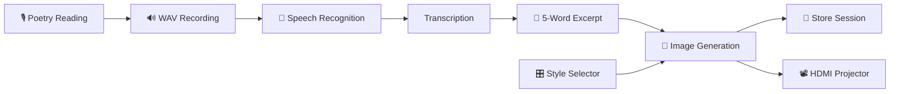

# 🎨 Poetry Wall

> **Current version: [Poetry Wall 2.0](README-2.0.md)** — Pollinations free tier, no API keys, text-input mode, 16 styles, session manifests, slideshow gallery and a local image fallback. Start there.
>
> The documentation below describes the original **1.0 (2023)** installation with OpenAI/DALL·E 2, kept for reference.

### Illustrating live poetry readings with Speech Recognition, OpenAI and generative images (1.0)

[](https://www.raspberrypi.com/products/raspberry-pi-3-model-b/)
[](https://pollinations.ai/)
[](https://www.python.org/)
[](LICENSE)

**Roni Bandini — Buenos Aires, Argentina — March 2023**

**Poetry Wall** is an installation that listens to a poetry reading, converts speech to text, summarizes the transcription with an AI language model, generates an illustration from that summary and projects the image onto a wall.

The original 2023 implementation combines a **[Raspberry Pi 3](https://www.raspberrypi.com/products/raspberry-pi-3-model-b/)**, USB microphone, HDMI projector, 16-position selector, Speech Recognition, ChatGPT-era OpenAI text generation and DALL·E 2.

The same system can also illustrate prose, conversations or other spoken text.

---

## ✨ Features

* 🎙️ Records live readings through USB microphone
* 📝 Speech-to-text transcription
* 🧠 AI-generated five-word excerpt
* 🎨 AI image generation
* 🎛️ 16 selectable visual styles
* 📽️ HDMI wall projection
* 🆔 UUID-based session files
* 💾 Stores WAV, text and generated images
* 🐍 Python on Raspberry Pi
* 📚 Poetry or prose input

---

# 🏗️ Architecture



The original pipeline can be summarized as:

```text
speech
  ↓
WAV recording
  ↓
speech recognition
  ↓
transcription
  ↓
5-word AI excerpt
  ↓
excerpt + selected visual style
  ↓
AI illustration
  ↓
wall projection
```

---

# 🛠️ Hardware

| Component                                                                      | Function                  |
| ------------------------------------------------------------------------------ | ------------------------- |
| [Raspberry Pi 3](https://www.raspberrypi.com/products/raspberry-pi-3-model-b/) | Runs the installation     |
| USB microphone                                                                 | Records the reading       |
| HDMI projector                                                                 | Projects generated images |
| HDMI cable                                                                     | Video output              |
| DFRobot 16-position encoder                                                    | Selects visual style      |
| 5 V power supply                                                               | Raspberry Pi power        |

The selector uses four GPIO lines to represent **16 positions**.

The project configuration uses:

```python
code1Pin = 5
code2Pin = 6
code3Pin = 13
code4Pin = 19
```

DFRobot documentation for its 16-position 8421 encoder family:

👉 **[DFRobot 8421 16-position Encoder](https://wiki.dfrobot.com/dfr0721/)**

---

# 🎙️ 1. Record the Reading

The repository includes:

👉 **[`recordWav.py`](https://github.com/ronibandini/poetrywall/blob/main/recordWav.py)**

Audio is recorded using Linux `arecord`.

First identify the USB microphone:

```bash
arecord -l
```

Test it with:

```bash
arecord -D plughw:1,0 --duration=3 --rate 44100 test.wav
```

The Python module generates a unique filename with:

```python
filename = str(uuid.uuid4())
```

and invokes:

```python
os.system(
    "arecord -D plughw:" +
    str(usbMicCard) +
    ",0 --duration=" +
    str(recordingTime) +
    " " +
    filename +
    ".wav"
)
```

Default recording time in the example:

```python
recordingTime = 10
```

---

# 📝 2. Speech Recognition

The next stage is implemented in:

👉 **[`speechRecon.py`](https://github.com/ronibandini/poetrywall/blob/main/speechRecon.py)**

It uses the **[SpeechRecognition Python library](https://pypi.org/project/SpeechRecognition/)**:

```python
import speech_recognition as sr
```

The WAV file is loaded and ambient noise is evaluated:

```python
r = sr.Recognizer()

audio_file = sr.AudioFile("test.wav")

with audio_file as source:
    r.adjust_for_ambient_noise(source)
    audio = r.record(source)
```

The repository example recognizes Spanish:

```python
result = r.recognize_google(
    audio,
    language="es-ES"
)
```

The transcription can then be stored as a `.txt` file.

---

# 🧠 3. Generate an Excerpt

Sending an entire poem directly to an image generator can produce an unfocused visual prompt.

Poetry Wall therefore adds an intermediate AI stage:

```text
full transcription
       ↓
five-word excerpt
       ↓
image prompt
```

The example is available at:

👉 **[`excerpt.py`](https://github.com/ronibandini/poetrywall/blob/main/excerpt.py)**

The original 2023 code used:

```python
model_engine = "text-davinci-003"
```

with a prompt equivalent to:

```text
Summarize in a five-word sentence:
<transcribed poem>
```

This creates a much smaller semantic representation of the reading before generating the illustration.

The repository preserves the original **2023 OpenAI API syntax**. Current OpenAI API documentation is available here:

👉 **[OpenAI Developer Quickstart](https://platform.openai.com/docs/quickstart)**

---

# 🎨 4. Generate the Illustration

Image generation is demonstrated in:

👉 **[`text2illustration.py`](https://github.com/ronibandini/poetrywall/blob/main/text2illustration.py)**

The original version used DALL·E 2 and requested a:

```text
512 × 512
```

image.

```python
response = openai.Image.create(
    prompt=query,
    n=1,
    size="512x512"
)
```

The returned image URL was downloaded with `requests` and stored locally:

```python
img_data = requests.get(res).content

with open("test.jpg", "wb") as handler:
    handler.write(img_data)
```

For current image-generation APIs see:

👉 **[OpenAI API Documentation](https://platform.openai.com/docs/overview)**

---

# 🎛️ Visual Style Selector

A physical 16-position selector changes the visual instruction added to the prompt.

The original installation included:

| Position | Style                              |
| -------: | ---------------------------------- |
|        0 | Realistic painting                 |
|        1 | Impressionist painting             |
|        2 | Abstract painting                  |
|        3 | Surrealist painting                |
|        4 | Pop Art                            |
|        5 | Cyberpunk digital painting         |
|        6 | M. C. Escher-inspired drawing      |
|        7 | Katsushika Hokusai print           |
|        8 | Picasso-inspired abstract painting |
|        9 | Quinquela Martín-inspired painting |
|       10 | Antonio Berni-inspired painting    |
|       11 | Salvador Dalí-inspired painting    |
|       12 | Ralph Steadman-inspired drawing    |
|       13 | Leonardo da Vinci-inspired drawing |
|       14 | Oil painting                       |
|       15 | Pointillist painting               |

The selector lets the audience change the visual interpretation without modifying the software.

---

# 💾 Session Files

Every iteration creates a UUID that associates the original recording with its text and image.

For example, the repository contains:

```text
8e870250-b5d6-42cf-9c90-34a511657b29.wav
8e870250-b5d6-42cf-9c90-34a511657b29.txt
8e870250-b5d6-42cf-9c90-34a511657b29.jpg
```

This creates a direct relationship between:

```text
audio → transcription → illustration
```

Example files:

* 🔊 **[WAV recording](https://github.com/ronibandini/poetrywall/blob/main/8e870250-b5d6-42cf-9c90-34a511657b29.wav)**
* 📝 **[Transcription](https://github.com/ronibandini/poetrywall/blob/main/8e870250-b5d6-42cf-9c90-34a511657b29.txt)**
* 🎨 **[Generated illustration](https://github.com/ronibandini/poetrywall/blob/main/8e870250-b5d6-42cf-9c90-34a511657b29.jpg)**

---

# ⚙️ Original Installation Settings

The complete 2023 installation used settings similar to:

```python
audioLanguage = "Spanish"

recordingTime = 30
imageSeconds = 15
loopSeconds = 1

debugMode = 1
usbMicCard = 1

excerptEnabled = 1

code1Pin = 5
code2Pin = 6
code3Pin = 13
code4Pin = 19

chatGPTTemperature = 0.5
chatGPTMaxTokens = 1024
```

These values control recording length, projection time, microphone selection, encoder GPIO and text-generation parameters.

---

# 🚀 Installation

## 1. Install Raspberry Pi OS

Install:

👉 **[Raspberry Pi OS](https://www.raspberrypi.com/software/)**

The original project used Raspberry Pi OS Desktop because the same computer also drives the HDMI projector.

---

## 2. Install audio tools

```bash
sudo apt update
sudo apt install alsa-utils python3-pip
```

Check the microphone:

```bash
arecord -l
```

---

## 3. Clone the repository

```bash
git clone https://github.com/ronibandini/poetrywall.git
cd poetrywall
```

Repository:

👉 **[github.com/ronibandini/poetrywall](https://github.com/ronibandini/poetrywall)**

---

## 4. Install Python modules

The example modules require packages including:

```bash
pip3 install requests SpeechRecognition
```

The preserved OpenAI examples use the Python API structure available when the project was created in **March 2023**.

For a current implementation, see:

👉 **[OpenAI API Quickstart](https://platform.openai.com/docs/quickstart)**

The complete installation described in the project article also used **[OpenCV](https://opencv.org/)** for displaying generated images through the projector.

---

# 📁 Repository Structure

```text
poetrywall/
│
├── recordWav.py
├── speechRecon.py
├── excerpt.py
├── text2illustration.py
│
├── 8e870250-b5d6-42cf-9c90-34a511657b29.wav
├── 8e870250-b5d6-42cf-9c90-34a511657b29.txt
├── 8e870250-b5d6-42cf-9c90-34a511657b29.jpg
│
├── README.md
└── LICENSE
```

### Modules

* 🎙️ **[`recordWav.py`](https://github.com/ronibandini/poetrywall/blob/main/recordWav.py)** — USB microphone recording
* 📝 **[`speechRecon.py`](https://github.com/ronibandini/poetrywall/blob/main/speechRecon.py)** — speech-to-text
* 🧠 **[`excerpt.py`](https://github.com/ronibandini/poetrywall/blob/main/excerpt.py)** — five-word AI excerpt
* 🎨 **[`text2illustration.py`](https://github.com/ronibandini/poetrywall/blob/main/text2illustration.py)** — AI illustration generation
* ⚖️ **[MIT License](https://github.com/ronibandini/poetrywall/blob/main/LICENSE)**

The repository contains **standalone examples for the individual Poetry Wall stages**. The complete installation workflow is documented in the articles below.

---

# 🎥 Demo

▶️ **[Poetry Wall Demo — YouTube](https://www.youtube.com/watch?v=Kz7ZRaHd-DI)**

The demo shows a poetry reading being transformed into projected AI-generated imagery.

---

# 🌐 External References

## 🛠️ Hackster.io

Complete English-language project article covering the hardware, speech recognition, AI excerpt generation, image generation, style selector and projection.

👉 **[Poetry Wall — Hackster.io](https://www.hackster.io/roni-bandini/poetry-wall-62214f)**

---

## 🇦🇷 Medium

Detailed Spanish-language article covering the installation and examples based on Federico García Lorca and Adolfo Bioy Casares.

👉 **[Poetry Wall: ilustración de lecturas de poesía con inteligencia artificial vía OpenAI DALL·E 2 — Medium](https://bandini.medium.com/poetry-wall-ilustraci%C3%B3n-de-lecturas-de-poes%C3%ADa-con-inteligencia-artificial-v%C3%ADa-openai-dall-e2-3c289decb121)**

---

## 📰 Infobae

Poetry Wall is discussed in this profile about literary machines combining technology, literature and physical installations.

👉 **[Roni Bandini, el inventor de las máquinas literarias que homenajean a Borges, Levrero y Cortázar — Infobae](https://www.infobae.com/educacion/2023/11/23/roni-bandini-el-inventor-de-las-maquinas-literarias-que-homenajean-a-borges-levrero-y-cortazar/)**

---

# 🔗 Related GitHub Projects

### 🥧 PiemPi

A Raspberry Pi machine that calculates digits of π and converts them into automatically generated poetry.

👉 **[github.com/ronibandini/piemPi](https://github.com/ronibandini/piemPi)**

### 🪪 MIFARE Poetry

Micropoetic ephemeral writing using MIFARE cards as the physical medium.

👉 **[github.com/ronibandini/MIFAREPoetry](https://github.com/ronibandini/MIFAREPoetry)**

### 🧠 AI Remember

Generative literature inspired by the *I Remember* form associated with Joe Brainard and Georges Perec.

👉 **[github.com/ronibandini/AIRemember](https://github.com/ronibandini/AIRemember)**

### 🚶 The Walk

A physical machine that virtually walks through Buenos Aires and generates a travel journal.

👉 **[github.com/ronibandini/TheWalk](https://github.com/ronibandini/TheWalk)**

### 👁️ Furby Borges

A 1998 Furby converted into a Jorge Luis Borges animatronic using Arduino and DFPlayer Mini.

👉 **[github.com/ronibandini/furby](https://github.com/ronibandini/furby)**

---

# 📕 Contracultura Maker

**Contracultura Maker** is a book by Roni Bandini about maker culture, experimental electronics, AI, physical computing and technological autonomy.

📂 **[Contracultura Maker — GitHub repository](https://github.com/ronibandini/ContraculturaMaker)**

📕 **[Download Contracultura Maker PDF](https://github.com/ronibandini/ContraculturaMaker/raw/refs/heads/main/ContraculturaMaker2.pdf)**

---

# 📬 Contact

**Roni Bandini**
Maker · AI Developer · Writer
Buenos Aires, Argentina

* 🐙 [GitHub — @ronibandini](https://github.com/ronibandini)
* 🌐 [Medium — @ronibandini](https://bandini.medium.com/)
* 𝕏 [X / Twitter — @RoniBandini](https://x.com/RoniBandini)
* 📸 [Instagram — @ronibandini](https://www.instagram.com/ronibandini/)
* ▶️ [YouTube — @RoniBandini](https://www.youtube.com/@RoniBandini)
* 💼 [LinkedIn — Roni Bandini](https://www.linkedin.com/in/ronibandini/)

---

Built with 🎙️ + poetry + AI + Raspberry Pi.
